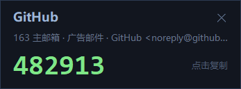
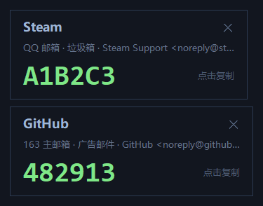
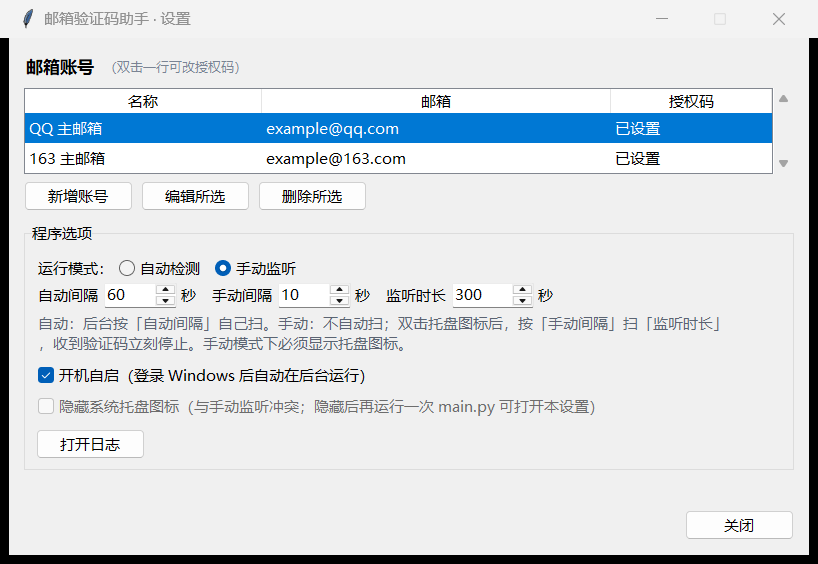

# 邮箱验证码助手（Mail OTP Assistant）

Windows 后台常驻小工具：自动登录 QQ / 163 / 126 邮箱 → **全文件夹**扫描新邮件 → 认出验证码 →
屏幕右下角弹窗 → **点一下就把验证码复制到剪贴板**（60 秒后自动清空剪贴板）。
托盘常驻、开机自启、多个验证码竖排排队。

> 只连 IMAP、只读（`EXAMINE` + `BODY.PEEK`），不改已读、不删邮件；授权码用 Windows DPAPI 加密。

## 截图

| 验证码卡片（点一下即复制） | 多个验证码自动排队 |
|---|---|
|  |  |

设置窗（账号 / 运行模式 / 开机自启 / 隐藏托盘）：



> 截图里的账号是 `example@qq.com`、`example@163.com`，里面的验证码是 `--demo` 生成的假数据。

## 环境要求

| 项目 | 要求 |
|---|---|
| 系统 | Windows 10 / 11 |
| Python | 3.12（自带 `tkinter`） |
| 依赖 | `pystray`、`pillow`（`pip install pystray pillow`） |
| 邮箱 | 开了 IMAP 的 QQ / 163 / 126 / yeah 邮箱 + 授权码 |

## 从源码运行

```bat
pip install pystray pillow
python main.py --check    :: 先做体检：连账号、列出会被扫描的文件夹
python main.py            :: 正常后台运行（托盘）
```

第一次用先填授权码：双击 `填写授权码.bat`，或在托盘图标右键 →「设置…」里填。

## 打包成单文件 exe（可选）

```powershell
pip install pyinstaller
$env:PYTHONUTF8=1
pyinstaller --noconfirm --clean --onefile --noconsole `
  --name "邮箱验证码助手" --icon "assets\mail_otp.ico" --hidden-import pystray._win32 `
  main.py
```

打包版的命令行参数同样可用：`--arm`、`--autostart on|off|status`、`--desktop-shortcut`。
（`--check` / `--once` 是给源码运行时的诊断输出；exe 无控制台，诊断请跑源码版。）

## 日常怎么用

1. 程序在托盘里（信封图标）。有验证码时右下角弹一张卡片：站点名 + 账号/文件夹 + 大号验证码，
   卡片大小按内容自适应（约 300×130），不留空白。
2. **点卡片任意位置** → 验证码进剪贴板，提示“已复制 ✓”。
3. 粘贴到网页里。40 秒没人点，卡片自己消失；多个验证码会竖着排队。
4. 托盘右键：立即检查 / 暂停检查 / **设置…** / 打开日志 / 退出。
5. 设置窗里还有：**运行模式**（自动 / 手动）、**开机自启**、**隐藏系统托盘图标**、**打开日志**（见下）。

## 运行模式：自动 / 手动

设置窗「程序选项 → 运行模式」里切换，立即生效：

| 模式 | 行为 |
|---|---|
| 自动检测（默认） | 后台每 60 秒自己扫一次，全程不等你操作 |
| 手动监听 | **完全不自动扫**；双击托盘图标后进入 5 分钟监听窗，每 10 秒扫一次；**一收到验证码立刻停止**；5 分钟到也自动停 |

- 托盘图标提示会显示「手动模式（双击托盘开始监听）」，监听中显示倒计时 `监听中 3:42`。
- **间隔/时长可在设置里改**：自动间隔（15–3600 秒）、手动间隔（5–600 秒）、监听时长（30–3600 秒）；
  改完聚焦离开输入框或按回车即保存生效，越界自动夹紧，写进 `config.json`。
- **与「隐藏系统托盘图标」互斥**：切到手动监听时该项自动置灰（并强制取消隐藏、把托盘显示出来）；
  手动模式下勾选隐藏会被拒绝。启动时若配置是「隐藏 + 手动」，也会自动改回显示托盘。
- 托盘菜单第一项在手动模式下变成「**开始监听（5 分钟）**」，监听中多一个「停止监听」。
- 不用鼠标也行：`python main.py --arm` 会让已在运行的实例开始监听。
- 参数在 `config.json`：`manual_window_seconds`（默认 300）、`manual_poll_seconds`（默认 10，最小 3）。
- 注意：手动模式靠托盘图标触发，别同时勾「隐藏系统托盘图标」。

## 程序选项（设置窗底部）

- **开机自启**：勾上 = 在启动文件夹放「邮箱验证码助手.lnk」（经 `run_hidden.vbs`，pythonw 无窗口启动）；
  取消勾选 = 删除该快捷方式。勾选状态就是真实状态（直接看启动文件夹里有没有）。
- **隐藏系统托盘图标**：勾上后托盘图标消失（程序照样扫、照样弹窗），配置存 `hide_tray`。
  **怎么找回来**：
  1. 再运行一次 `main.py`（或双击任意启动它的快捷方式）→ 已在运行的实例会**自动弹出设置窗**（靠命名事件 IPC，不依赖托盘）；
  2. 在设置窗里取消勾选「隐藏系统托盘图标」。
- **打开日志**：直接打开 `logs/app.log`，和托盘菜单里那一项一样。

> 隐藏托盘后不建议同时关掉所有入口：设置窗是从「再运行一次程序」打开的这一条路，别把启动快捷方式也删了。

## 第一次配置（填授权码）

**推荐：托盘图标右键 →「设置…」**，在窗口里填（不用开命令行）：

1. 设置窗平时只显示账号列表 +「新增账号 / 编辑所选 / 删除所选」+ 程序选项；
   **账号表单默认隐藏**，点「新增账号」或「编辑所选」（也可以双击列表某行）才展开。
2. 新增：类型选 QQ/163/126/yeah → 填邮箱地址和显示名；改授权码：邮箱/类型只读，只填授权码。
3. 授权码框默认显示 `*`，可勾「显示」核对；**「验证并保存」就在授权码下面**——
   程序后台真实登录验证，成功才用 DPAPI 加密写入并立刻开始扫描；失败红字提示原因，
   可换码重试，或点「离线直接保存」（不推荐）。
4. 保存/取消后表单自动收起、窗口跟着变矮；列表「授权码」列会变成「已设置」。

也可以在命令行里填（等价）：

```bat
python set_password.py
```

- 程序会**隐藏输入**（屏幕上一个字都不显示，这是正常的），直接粘贴授权码、回车。
- 程序会**先试登录**验证：成功才加密保存，失败重试 3 次。
- 明文不落盘、不写日志、不进聊天记录；`config.json` 里只有 DPAPI 密文（只对当前 Windows 用户可解）。

授权码从哪儿来：

| 邮箱 | 网页操作 |
|---|---|
| QQ | 邮箱网页版 → 设置 → 账号 → 开启「IMAP/SMTP 服务」→ 生成授权码 |
| 163 | 邮箱网页版 → 设置 → POP3/SMTP/IMAP → 开启 IMAP → 新增授权密码 |

Gmail 不需要填：在 Gmail 网页版把邮件**自动转发**到 QQ/163，程序只连 QQ/163，所以不用一直开梯子。

其他命令：

```bat
python set_password.py --list            看账号和授权码状态
python set_password.py --add             加一个账号（qq / 163 / 126）
python set_password.py --account qq      给某个账号重填授权码
python set_password.py --test            验证已存的授权码还能不能登录
python set_password.py --remove qq       删除账号
```

## 体检 / 调试

```bat
python main.py --check     连接各账号、列出所有被扫描的文件夹和邮件数
python main.py --once      只扫一轮，把识别到的验证码打到控制台
python main.py --demo      弹两个假卡片看样式
python main.py --arm       让已在运行的实例开始手动监听（不用点托盘）
python main.py             正常后台运行（带托盘）
```

## 开机自启

两种改法等价：**设置窗里勾/取消「开机自启」**，或者命令行：

```bat
python install_autostart.py --status    看装没装
python install_autostart.py             安装（写入启动文件夹快捷方式）
python install_autostart.py --remove    取消
python install_autostart.py --start     现在就后台启动
```

自启走 `run_hidden.vbs`（由安装脚本生成），用 pythonw 启动，不闪黑框。

## 文件说明

| 文件 | 作用 |
|---|---|
| `main.py` | 入口（常驻 / `--check` / `--once` / `--demo`） |
| `set_password.py` | 现场填授权码（隐藏输入 + 试登录 + DPAPI 加密） |
| `填写授权码.bat` | 双击填授权码 |
| `config.json` | 账号配置；授权码是 `password_dpapi` 密文 |
| `state.json` | 每个文件夹扫到哪儿（last_uid）、已处理邮件、最近弹过的码 |
| `logs/app.log` | 日志（**只记站点，不记验证码**），1MB × 3 轮转 |
| `run_hidden.vbs` | 无窗口启动器（安装脚本生成） |
| `mailotp/` | 程序模块：`imap_scan` / `otp` / `popup` / `tray_icon` / `store` / `dpapi` … |
| `tests/test_otp.py` | 识别规则回归测试：`python tests/test_otp.py` |
| `_dev/` | 开发期脚本（发测试邮件、端到端验收）；不是运行必需 |

## 行为细节

- **全文件夹扫描**：收件箱、广告邮件、订阅邮件、垃圾箱等都只读扫描（`EXAMINE` + `BODY.PEEK`），
  不改已读、不删邮件。文件夹自动发现，新出现的分类下一轮就会扫到。
- **不扫这些文件夹**（`config.json` 的 `skip_folders`，默认）：已发送 / 草稿箱 / 已删除 / Sent / Drafts / Deleted Messages。
  原因：你自己发出去的信里带验证码，扫「已发送」会给自己弹一堆没用的卡片。
  想改就编辑 `skip_folders` 数组（按名字模糊匹配，大小写不敏感）。
- **省流**：先 `STATUS (MESSAGES UIDNEXT)` 比对，没变化就不抓正文；QQ 支持 UIDNEXT 快速判断，
  163 不回 UIDNEXT，退化成「EXAMINE + UID SEARCH」，仍然不抓正文。
- **首次运行**：每个文件夹先建基线（记住当前最大 UID），不把历史邮件全弹出来。
- **去重**：按 `Message-ID` 记 48 小时；同一个验证码 5 分钟内不重复弹。
- **一封邮件多个验证码**：把几封验证码信打包转发时，会按得分弹最多 3 张卡
  （`config.json` 的 `max_codes_per_mail`，默认 3）；同一封里只有一个码时行为不变。
- **附件转发也能认**：QQ/Outlook 把原邮件当 `.eml` 附件转发时正文是空的，程序会递归进 `message/rfc822`
  和 `.eml` 附件（含附件名本身）里找验证码；一封邮件只弹最像的那个码。
  图片型验证码（正文/验证码是图片）不做 OCR，认不出。
- **2FA / 双重登入措辞**：`双重登入代码`、`登入代码`、`两步验证`、`2FA`、`two-factor code`、
  `login code` 等也视作验证码关键词（Epic 这类繁体 2FA 邮件常用这套说法）。
- **繁体 / 全角也能认**：先把繁体常用字转简体、全角数字转半角，再套同一套规则
  （例：`驗證碼`、`電子郵件驗證`、`１２３４５６`）。
  转发来的邮件（正文带「原始邮件/发件人：」）站点名从正文里的发件人行猜，不会显示成你自己的名字。
- **识别**：关键词（验证码/校验码/动态码/verification code/OTP…）+ 附近 4–8 位数字或字母数字码，
  排除年份、金额、订单号、电话、URL 里的数字。
- **剪贴板**：复制后 60 秒自动清空，**仅当剪贴板里还是这个码**（期间你复制了别的东西就不动）。

## 已知限制

- 独占全屏的游戏/视频上，置顶窗可能显示不出来（无边框全屏无法覆盖）。
- 只连 IMAP；Gmail 靠转发，不走 Gmail 接口。
- 授权码换用户名/重装系统后解不开，要重新跑 `填写授权码.bat`。


## 隐私与安全

- 授权码用 Windows **DPAPI** 加密（`CryptProtectData`，只对当前 Windows 用户可解），明文不落盘、不进日志。
- IMAP 全程**只读**：`EXAMINE` + `BODY.PEEK`，不改已读状态、不删邮件、不移动邮件。
- 日志**只记站点名与账号**，不记验证码本身；`1 MB × 3` 轮转。
- 剪贴板里是验证码时，60 秒后自动清空（期间你复制了别的东西就不动）。
- 仓库里不含任何账号配置：`config.json` / `state.json` / `logs/` 都在 `.gitignore` 里；
  首次运行会以 `config.example.json` 的默认值起步。
- 本工具需要你自己在邮箱网页版开 IMAP 并生成授权码；它不会索要你的登录密码。

## 免责声明

自用工具，按「现状」提供。验证码属于敏感信息，请自己评估在哪些机器上运行、
不要把 `%APPDATA%` 下的配置目录或日志分享给别人。

## License

MIT
